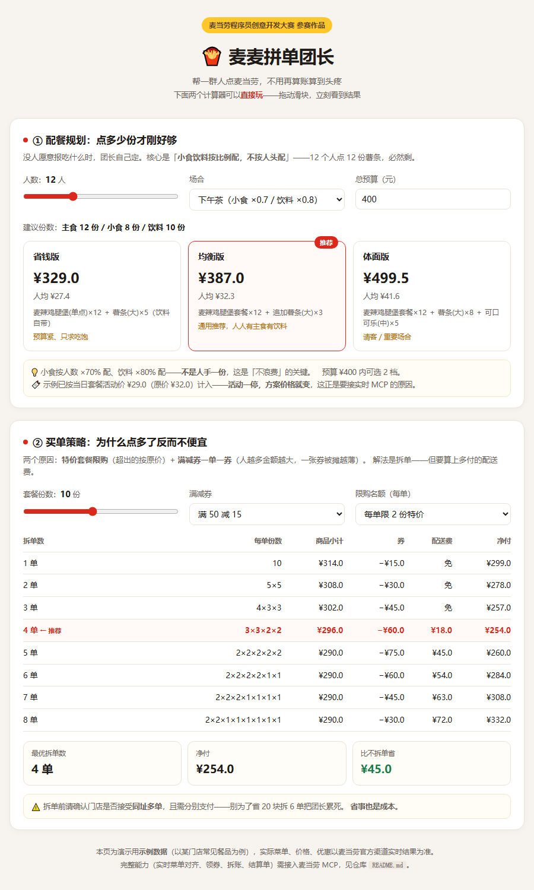
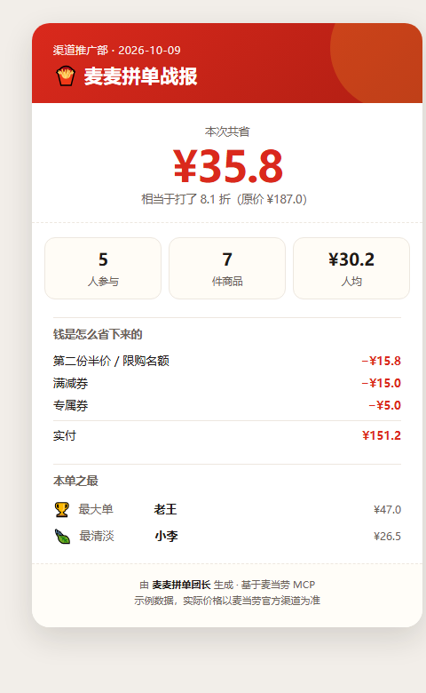
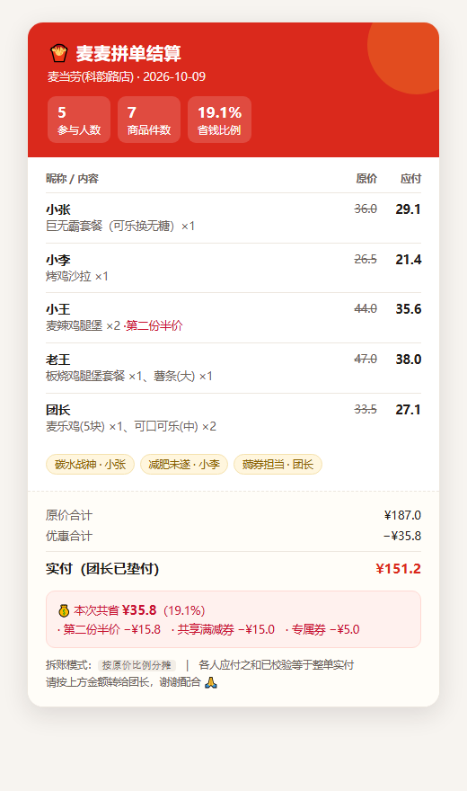

# 🍟 麦麦拼单团长

**mcd-group-order-captain**

> 帮一群人点麦当劳，不用再算账算到头疼。

一个人点麦当劳，三分钟。**十几个人点麦当劳，一小时，而且最后算账算到头疼。**

这个项目把「团长」这个角色的**完整工作流**自动化：从收单、配餐、省钱，到按人拆账、出一张能直接甩进微信群的结算单。

基于**麦当劳中国 MCP**（`https://mcp.mcd.cn`）实时能力构建。

---

## 🎮 先玩一下（不用装任何东西）

打开 **[`demo/index.html`](./demo/index.html)**，拖动滑块就能体验：

- **配餐规划**：人数 / 场合 / 预算 → 三档方案（吃饱 / 吃好 / 不浪费）
- **买单策略**：份数 / 满减券 / 限购名额 → 拆单对比，自动标出净付最低那档



---

## 和「点餐优化」类项目有什么不一样

榜单上已有若干聚焦**一份订单怎么点更便宜**的项目。本项目解决的是另一个问题：

**当你要替十几个人点餐时，从头到尾会发生什么？**

| | 一份订单优化 | 麦麦拼单团长 |
|---|---|---|
| 视角 | 一份订单的价格 | 一个**角色**的完整工作流 |
| 收单 | — | 口语转结构化，6 条容错规则 |
| 配餐 | — | 按人数配份数，吃饱 / 吃好 / 不浪费 |
| 省钱 | ✓ | ✓ 并区分「按单限购」与「按人限购」 |
| 拆单 | — | ✓ 算上配送费的临界判断 |
| 拆账 | — | ✓ 三种分摊模式，分毫不差 |
| 交付物 | 一份价格清单 | **一张能直接发微信群的结算单** |

---

## 它解决什么

群里喊一声「有人要麦当劳吗」，然后十个人十个说法扔过来：

> 「我要巨无霸套餐，可乐换无糖」
> 「我减肥，来点清淡的」
> 「随便，你点啥我吃啥」
> 「跟老王一样」
> 「麦当劳那个新出的叫啥来着」
> 「我要两份，给我老婆带一份」

团长接下来要：逐个翻译成人话商品 → 翻菜单找编码 → 领券 → 凑满减 → 比套餐 → 下单 → 最后还得拆账（「你 32.5、你 28、你 45.5……」少收了自己亏，多收了尴尬）。

**这个 Skill 把这一整套变成一次对话。**

---

## 三种使用场景

| 场景 | 你的处境 | Skill 给你什么 |
|---|---|---|
| **A · 收单拼单** | 群里已经报了一堆「随便」「跟老王一样」 | 翻译标准商品 → 凑单 → 拆账 → 结算单 |
| **B · 团餐规划** | 没人愿意报，让你决定；怕点少了不够、点多了浪费 | 按人数给「吃饱 / 吃好 / 不浪费」三档方案 |
| **C · 买单策略** | 东西定了，但「单点一份套餐便宜，点多了就不便宜」 | 吃满限购名额 + 拆单，算出最省买法 |

三种可以串起来用：**B 配餐 → C 买单 → A 拆账**。

---

## 两个让它「用得住」的设计

### 🧠 团长记忆：第二次几乎零输入

拼单是**高频重复**的事。所以项目会记住每个人的常用单和忌口，下次一句「还是老样子」就够了：

```bash
python scripts/roster.py add 小张 --usual "巨无霸套餐:可乐换无糖" --avoid 洋葱
python scripts/roster.py usual 小张 老王 小李
```

```
📋 还是老样子 · 3 人
小张    巨无霸套餐×1（可乐换无糖）
小李    烤鸡沙拉×1
小王    麦辣鸡腿堡×2
⚠️ 配餐前必看：小李 忌口：辣、牛肉
```

> 别的工具算的是「这一次便宜多少」，团长记忆算的是「**第一百次省多少事**」。
> ⚠️ `roster.json` 含他人口味偏好，属本地个人数据，已在 `.gitignore` 中排除。

### 📣 拼单战报：分享图自带传播

结算完自动生成一张战报：**本次共省 ¥XX**、人均、钱是怎么省下来的、本单之最。



团长会自发把它发到群里——**每一次分享都是一次曝光**。

---

## 效果示例



*↑ 结算单卡片：团长算完账，一张图直接甩进群里*

### 场景 B · 配餐规划（12 人下午茶）

```
建议份数：主食 12 份 / 小食 8 份 / 饮料 10 份

省钱版   ¥329.0   人均 27.4   预算紧、只求吃饱
均衡版   ¥423.0   人均 35.3   通用推荐 ⭐
体面版   ¥535.5   人均 44.6   请客 / 重要场合
```

> 💡 小食按人数 ×70% 配、饮料 ×80% 配——**不是人手一份**。12 个人点 12 份薯条，必然剩。

**如果当天套餐正好有活动价**（29 元，原价 32），均衡版直接降到 ¥387.0，推荐档位从「省钱版」跳到「均衡版」——**同一笔预算能买到更好的方案**。

### 场景 C · 买单策略（10 份套餐 + 满 50 减 15 券）

```
拆单数   每单份数      商品小计     券      配送费      净付
1 单     10             346.0     15.0      0.0      331.0
2 单     5×5            332.0     30.0      0.0      302.0
3 单     4×3×3          318.0     45.0      0.0      273.0
4 单     3×3×2×2        304.0     60.0     18.0      262.0
5 单     2×2×2×2×2      290.0     75.0     45.0      260.0  ← 推荐
6 单     2×2×2×2×1×1    290.0     60.0     54.0      284.0

⭐ 最优：拆成 5 单，净付 ¥260.0（比不拆单省 ¥71.0）
```

注意第 6 单**反而更贵**了——多付的配送费超过了省下的券。这个平衡点脚本会自动找到。

### 场景 A · 拆账

```
昵称       原价      应付
小张       36.0      29.1
小李       26.5      21.4
小王       44.0      35.6
老王       47.0      38.0
团长       33.5      27.1
合计      187.0     151.2

[自检] 各人应付之和 ¥151.2 == 整单实付 ¥151.2  ✅ 通过
```

三种分摊模式可选（按原价比例 / 平均分摊 / 精确到人），**各人应付之和严格等于整单实付**，不会出现「加起来对不上」。

---

## 目标用户

- **办公室 / 部门的下午茶、加班餐负责人**（那个每次都被推出来点餐的人）
- **企业行政 / HR**：组织团建、福利餐、员工关怀活动
- **班级 / 社团 / 兴趣小组**的组织者
- 任何需要**帮一群人点麦当劳**的人

---

## 安装

### 1. 申请麦当劳 MCP Token

1. 打开 <https://open.mcd.cn/mcp>，手机号验证登录
2. 点右上角「控制台」→ 点「激活」申请 Token
3. 同意服务协议，一键复制 Token

### 2. 在 WorkBuddy 中配置 MCP

左侧边栏【专家·技能·连接器】→【连接器】→ 右上角【自定义连接器】→【配置 MCP】，粘贴：

```json
{
  "mcpServers": {
    "mcd-mcp": {
      "type": "streamablehttp",
      "url": "https://mcp.mcd.cn",
      "headers": {
        "Authorization": "Bearer ${MCD_MCP_TOKEN}"
      }
    }
  }
}
```

> ⚠️ 把 `${MCD_MCP_TOKEN}` 换成你的真实 Token，保存后**回到连接器列表把 `mcd-mcp` 启用**。
> 仓库内只提供占位符版本（`mcp-config.example.json`），**请勿提交真实 Token**。

### 3. 安装 Skill

把本仓库放入 WorkBuddy 技能目录（或在技能管理页上传打包的 zip），对话中输入 `/麦麦拼单团长` 调用。

### 4. 环境要求

- Python 3.10+（**仅标准库**，无需 pip 安装）
- 未配置 MCP 时自动进入**手动降级模式**，功能照常可用

---

## 使用示例

### 示例 1 · 收单拼单

> **你**：帮我点十几个人的麦当劳。小张要巨无霸套餐可乐换无糖，小李随便，小王两份麦辣鸡腿堡，老王跟小张一样但可乐不换。

> **Skill**：收到 4 人。已解析成：小张→巨无霸套餐×1（可乐换无糖）、小李→待推荐、小王→麦辣鸡腿堡×2、老王→巨无霸套餐×1。
> 先查今天门店菜单和活动……

### 示例 2 · 配餐规划

> **你**：12 个人下午茶，预算 400，我不收集大家吃啥，你直接配。

> **Skill**：主食 12 / 小食 8 / 饮料 10。均衡版 ¥423.0（人均 35.3）超预算 23 元；省钱版 ¥329.0（人均 27.4）在预算内。建议省钱版，或把套餐换成今日活动款可压到 ¥387。

### 示例 3 · 买单策略

> **你**：10 份巨无霸套餐，满 50 减 15 的券，怎么买最划算？

> **Skill**：建议拆 5 单，净付 ¥260.0，比不拆单省 ¥71.0。
> ⚠️ 拆单前请确认门店是否接受同址多单，且需分别支付。

### 命令行自测

```bash
python scripts/promo_scan.py  --demo            # 促销侦察
python scripts/plan_order.py plan --demo        # 配餐三档方案
python scripts/plan_order.py pay  --demo        # 买单拆单对比
python scripts/split_bill.py  --demo --mode A   # 拆账
```

仓库内 `examples/` 提供了对应的输入示例文件。

---

## 目录结构

```
mcd-group-order-captain/
├── README.md                  # 本文件
├── CONTEST_DECLARATION.md     # 参赛声明（官方原文）
├── MCP_INTEGRATION.md         # MCP 集成说明
├── mcp-config.example.json    # 脱敏 MCP 配置示例
├── workbuddy.md               # WorkBuddy 开发上下文
├── SKILL.md                   # Skill 主文件（三种模式的完整工作流）
├── scripts/
│   ├── promo_scan.py          # 促销侦察
│   ├── plan_order.py          # 配餐规划 + 买单策略
│   └── split_bill.py          # 拆账 + 凑单优化
├── references/
│   ├── mcd-mcp-tools.md       # 麦当劳 MCP 工具清单
│   └── settlement-template.md # 结算单输出模板
├── assets/
│   └── settlement-card.html   # 可截图的结算单卡片
└── examples/
    ├── order.sample.json
    ├── plan.sample.json
    ├── cart.sample.json
    └── promo.sample.json
```

---

## 设计理念

1. **吃得刚好，不是吃得最多。** 「不浪费」被做成可计算的规则（小食按 60%~80% 人数配、饮料按 80% 配），而不是靠感觉。
2. **省的钱要说得出理由。** 每次优化都要能解释「为什么省」，说不清的优化一律不做；省不了就如实说，不硬凑。
3. **拆账必须分毫不差。** 用最大余额法保证各人应付之和严格等于整单实付，不允许抹零糊弄。
4. **不替用户做主。** 有人没报就是没报，不猜；下单涉及真实支付，没有明确指令绝不自动执行。
5. **能力边界要诚实。** MCP 拿不到的字段（如限购数量与范围）显式标注为「必须人工确认」，不假装全自动。

---

## 免责声明

本项目为**麦当劳程序员节创意开发大赛参赛作品**，由参赛者独立开发，**非麦当劳官方产品**。

项目输出仅供参考，不构成医疗、营养或其他专业建议；餐品信息、价格及供应状态以麦当劳官方渠道的实时结果为准。

详见 [CONTEST_DECLARATION.md](./CONTEST_DECLARATION.md)。

## 许可

本项目采用 MIT 许可证，详见 [LICENSE](./LICENSE)。
